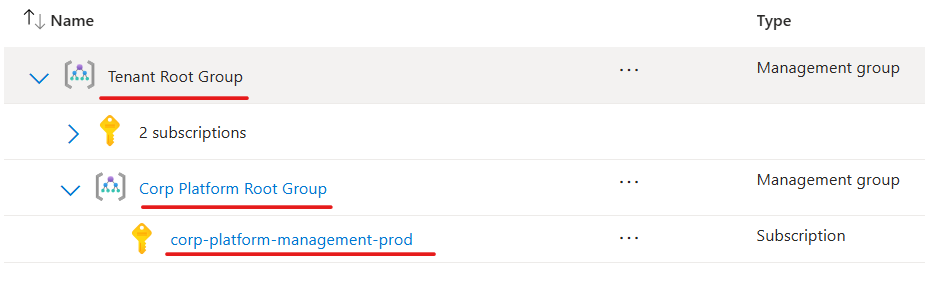
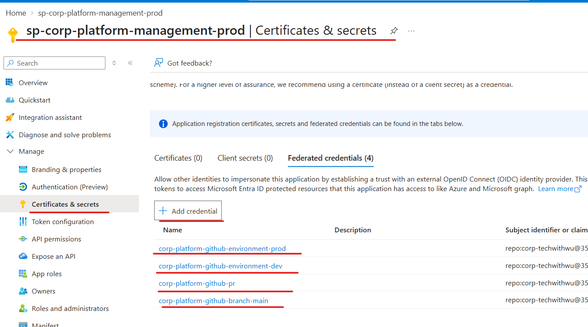
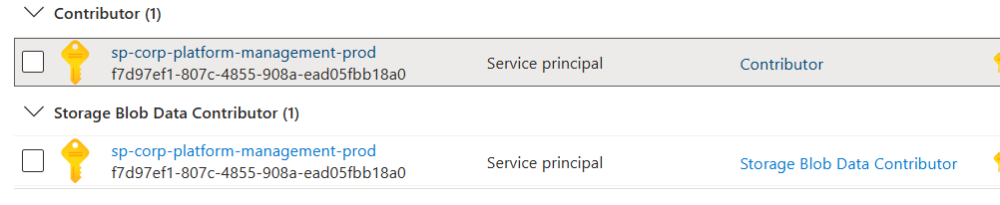
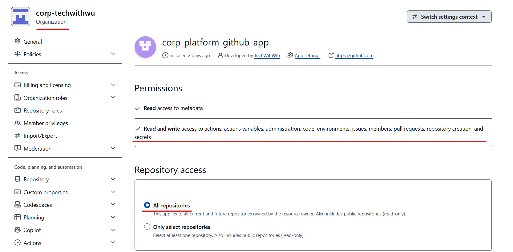
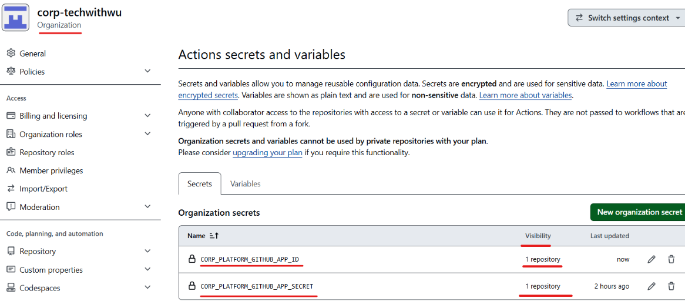
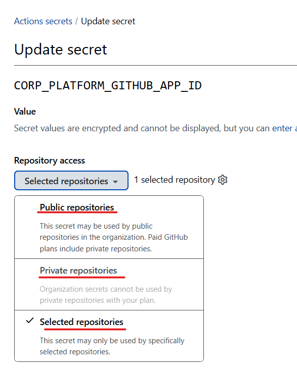
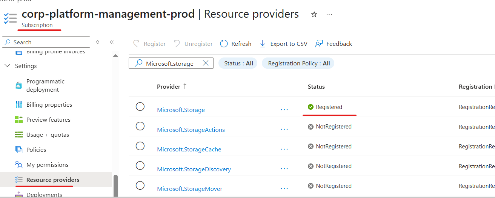

# corp-platform-github

GitHub-as-Code for managing GitHub organization governance with Terraform and GitHub Actions.

This project helps teams define and enforce platform standards across GitHub using version-controlled configuration rather than manual console clicks. It can manage:

- GitHub organization members and roles
- Teams and team membership
- Repositories and repository features
- Branch protection rules
- Deployment environments
- GitHub Actions integration with Azure OIDC

It is designed for organizations that want a consistent, repeatable, and auditable GitHub governance model.

## What this repository contains

- `githubascode/` — Terraform modules and configuration for GitHub-as-Code resources
- `scripts/` — Azure and GitHub bootstrap scripts
- `.github/workflows/` — GitHub Actions pipelines for validation, backend storage creation, and deployment
- `docs/` — supporting diagrams and screenshots
- `bootstrap.ps1` — Azure bootstrap script for OIDC and subscription setup

## Architecture overview

The repository uses Terraform to define GitHub resources declaratively through CSV-driven configuration. In practice, the flow looks like this:

1. Configure organization-level settings in the `githubascode/config/` folder.
2. Run Terraform to validate and apply the desired GitHub state.
3. Use GitHub Actions to run validation and deployment workflows.
4. Secure Azure access using OIDC instead of long-lived secrets.
5. Store Terraform state in Azure Storage to keep infrastructure management stateful and consistent.

## Prerequisites

Before using this repository, make sure you have:

- A GitHub organization
- An Azure subscription
- Azure CLI installed and authenticated
- PowerShell 7+
- A fork of this repository inside your own GitHub organization
- Permission to create GitHub App credentials and organization-level secrets

## Quick start

### 1. Fork and customize the repo

Fork `corp-platform-github` into your organization and push it to your own GitHub org(eg: `corp-techwithwu`).

#### Set your organization's Base permissions to No permissions. 

> [!IMPORTANT]
>
> Set the organization's Base permissions to No permissions.
>
> This flips your org into default-deny (allowlist) mode: newly invited members can see nothing​ until a repository or team grant explicitly gives them access.
>
> `Settings → Organization → Member privileges → Base permissions → No permissions`


Update the repository reference used by the `bootstrap.ps1` script to match your own organization/repository.

### 2. Bootstrap Azure and GitHub OIDC

Go to your azure portal, create a subscription and a management group(eg subscription: `corp-platform-management-prod`, management group: `Corp Platform Root Group`), and move your subscription into the created group.



Go your Azure Portal, and create a service principal(eg: `sp-corp-platform-management-prod`).

Once your service principal has been created, add github federated credentials. you can view your organization id and repo by github api(eg: `https://api.github.com/repos/corp-techwithwu/corp-platform-github`)  


Add `contributor` and `Storage Blob Data Contributor` role to subscription `corp-platform-management-prod`


And then retrieve the following values:
- `AZURE_CLIENT_ID`
- `AZURE_TENANT_ID`
- `AZURE_SUBSCRIPTION_ID`

Add these values as GitHub repository secrets:


> If you are using a personal Azure subscription, you can take advantage of script [bootstrap.ps1](./bootstrap.ps1).

### 3. Create a Github APP and Configure organization secrets

Create a GitHub App in your organization and assign following permissions:
```
Permissions:
 Read access to metadata

 Read and write access to actions, actions variables, administration, code, environments, issues, members, pull requests, repository creation, and secrets
```

And then install it in the org`corp-techwithwu`.



Store the app credentials as organization-level secrets:

- `CORP_PLATFORM_GITHUB_APP_ID`
- `CORP_PLATFORM_GITHUB_APP_SECRET`



You can also assign visibility to sub repositories in the settings. Adjust its visibility according to your needs.


### 4. Create the Terraform state backend

Use the workflow in:

- [create-terraform-storage-account.yml](.github/workflows/create-terraform-storage-account.yml)

This workflow creates the Azure storage account and container used by Terraform for remote state storage.

the storage account created in [create-terraform-storage-account.yml](.github/workflows/create-terraform-storage-account.yml) need to match the file [infraascode/env/prod/backend.hcl](infraascode/env/prod/backend.hcl).


It may took some time if it's the first time you run, as the fresh subscription usually doesn't have 'Microsoft.Storage' registered. the script will trigger the registering, but it may take several minutes. for more details look at [create-terraform-storage.sh](.github/scripts/create-terraform-storage.sh)



### 5. Create a branch and submit a PR

Create a feature branch from `main`, make your changes, and open a pull request against the default branch.

then the following two workflows will be triggered:

- [gac-terraform-unit-tests.yml](.github/workflows/gac-terraform-unit-tests.yml) — Terraform validation and unit-style checks
- [gac-terraform-test-plan-apply-prod.yml](.github/workflows/gac-terraform-test-plan-apply-prod.yml) — test, plan, and apply flow for production


## Repository structure

```text
.
├── .github/
│   └── workflows/
├── docs/
├── githubascode/
│   ├── config/
│   ├── modules/
│   ├── main.tf
│   ├── locals.tf
│   ├── variables.tf
│   ├── outputs.tf
│   └── README.md
├── scripts/
├── .gitignore
├── bootstrap.ps1
├── README.md
└── LICENSE
```

## Example lifecycle

A common workflow is:

1. Fork this repository into your organization.
2. Configure Azure OIDC and repository secrets.
3. Create the Terraform state storage backend.
4. Update CSV files in `githubascode/config/` to reflect your GitHub organization.
5. Validate and apply the configuration via GitHub Actions or Terraform commands.
6. Review and merge pull requests using your normal GitHub governance flow.

## Security notes

- Prefer OIDC over long-lived cloud credentials.
- Store sensitive values in GitHub Secrets instead of committing them to source control.
- Keep the GitHub App credentials at the organization level for shared access.
- Review branch protection and access policies before production rollout.

## License

This project is licensed under the MIT License. See the `LICENSE` file for details.

## Contributing

Contributions are welcome. Please open an issue or pull request with a clear description of the change and the problem it solves.
